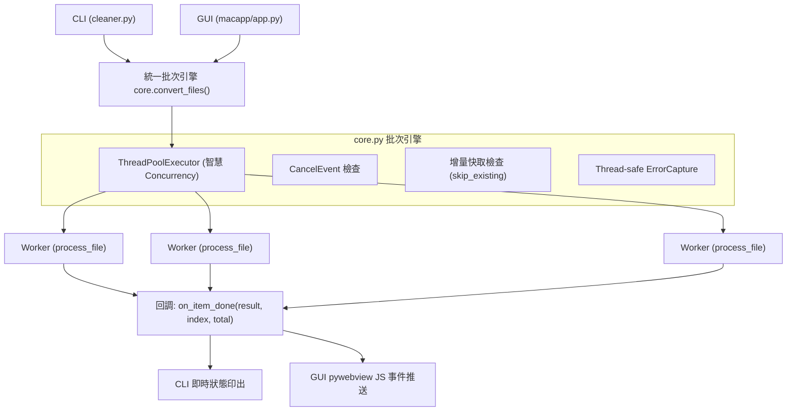

# doc-cleaner 整批轉換優化與架構重構設計規格書

- **日期**：2026-10-19
- **狀態**：Approved (已定案)
- **架構路徑**：Architectural

---

## 1. 背景與目標 (Background & Goals)

### 1.1 背景現況
目前 `doc-cleaner` 的批次文件轉換流程在 CLI（`cleaner.py`）與桌面端 GUI（`macapp/app.py`）存在以下問題：
1. **單執行緒阻塞**：批次檔案一律循序處理。在啟用 AI（如 Gemini, OpenAI, Groq）模式時，90% 以上時間花在等待 API 網路往返；若處理多個檔案，耗時極長。而在純提取模式（`--ai none`）下，亦無法善用現代多核 CPU 進行並行解析。
2. **重疊且重複的迴圈邏輯**：GUI 為了實現進度回報（`onProgress`）、單檔完成回調（`onResult`）以及中途取消（`self._cancel_event`），在 `macapp/app.py` 內自行實作了一套批次轉換迴圈，而未重用 `core.py:convert_files`，違反 DRY 原則且維護成本高。
3. **缺少增量轉換機制**：當批次處理大量檔案，若中途有新增檔案或中斷重試，無法自動跳過已完成且未變更的目標檔。
4. **多執行緒日誌干擾**：現有 `core._ErrorCapture` 為全域 logging handler，若直接並行會造成檔案之間的日誌與錯誤訊息互相污染。

### 1.2 重構目標
1. **統一核心批次引擎**：重構 `core.py` 中的 `convert_files`，使其具備並發執行、動態進度回調、單檔完成回調與取消機制。
2. **智慧並發控制**：
   - AI 模式：預設 3 個工作執行緒（避免打爆免費/商用 API 429 速率限制），可由參數自訂。
   - 本機 AI 模式（Ollama, MLX）：預設 1~2 個執行緒，保護本機記憶體與算力。
   - 純文字提取模式（`--ai none`）：預設 `min(8, os.cpu_count() or 4)` 個執行緒。
3. **消除 GUI 重複代碼**：`macapp/app.py` 全面委派給 `core.convert_files`。
4. **增量跳過支援（Incremental Conversion）**：新增 `skip_existing` 支援，若目標檔案已存在且其修改時間新於來源檔，則自動跳過，節省算力與 API Token。
5. **執行緒安全日誌捕獲（Thread-safe Error Capture）**：利用 Thread-local 隔離各任務的 warning/error 收集。
6. **保持向後相容**：維持既有 API 回傳格式、CLI 參數與 exit code 完全相容。

---

## 2. 系統架構與模組設計 (System Architecture)

### 2.1 架構總覽



---

## 3. 詳細規格設計 (Detailed Specification)

### 3.1 核心 API 規格（`core.py`）

#### 3.1.1 `convert_files` 函式簽名
```python
def convert_files(
    paths: list[str],
    output_resolver: callable = None,
    ai: str = "none",
    output_format: str = "md",
    config: dict = None,
    config_path: str = None,
    dry_run: bool = False,
    prompt_name: str = None,
    concurrency: int = None,
    on_item_done: callable = None,
    on_progress: callable = None,
    cancel_event: threading.Event = None,
    skip_existing: bool = False,
) -> list[dict]:
```

#### 3.1.2 智慧並發數計算邏輯
```python
def _calculate_concurrency(ai: str, user_concurrency: int = None, config: dict = None) -> int:
    # 1. 優先使用使用者命令列或 API 傳入的 concurrency
    if user_concurrency is not None and user_concurrency > 0:
        return user_concurrency
    
    # 2. 次之使用 config.json 中 batch.concurrency
    cfg_concurrency = (config or {}).get("batch", {}).get("concurrency")
    if cfg_concurrency and isinstance(cfg_concurrency, int) and cfg_concurrency > 0:
        return cfg_concurrency

    # 3. 根據 AI 模式自動計算
    ai_mode = (ai or "none").lower()
    if ai_mode == "none":
        import os
        return min(8, os.cpu_count() or 4)
    elif ai_mode in ("ollama", "mlx"):
        return 1  # 本機模型避免並發擠壓記憶體
    else:
        # 雲端 API (gemini, openai, groq, nvidia 等)
        return 3
```

#### 3.1.3 增量跳過（`skip_existing`）判斷
在單一檔案處理開始前進行檢核：
1. 取得預計輸出檔名與路徑 `expected_output_path = get_target_path(input_path, output_dir, output_format)`。
2. 若 `skip_existing=True` 且 `os.path.exists(expected_output_path)`：
   - 檢查 `os.path.getmtime(expected_output_path) >= os.path.getmtime(input_path)`。
   - 若成立，不呼叫 Parser 與 AI，直接返回：
     ```python
     {
         "file": Path(input_path).name,
         "input": str(Path(input_path).resolve()),
         "output": str(Path(expected_output_path).resolve()),
         "status": "skipped",
         "error": "已存在最新輸出檔，跳過",
     }
     ```

#### 3.1.4 執行緒安全錯誤捕獲（Thread-Safe Error Capture）
重構 `_ErrorCapture`：
```python
import threading

class _ThreadSafeErrorCapture(logging.Handler):
    """只收集當前執行緒產生的 warning 以上日誌。"""
    def __init__(self):
        super().__init__(logging.WARNING)
        self._local = threading.local()

    def set_thread_target(self):
        self._local.messages = []

    def get_messages(self):
        return getattr(self._local, "messages", [])

    def emit(self, record):
        if not hasattr(self._local, "messages"):
            return
        self._local.messages.append(record.getMessage())
```
在執行批次時，handler 掛載於全域 logger，但透過 `threading.local` 達成完全隔離。

#### 3.1.5 結果順序保證（Result Order Preservation）
- 即使各 worker 執行緒完成順序不同，`results` 列表仍需依照輸入 `paths` 的索引嚴格對齊儲存，確保 CLI summary 與自動化腳本行為一致。

---

### 3.2 CLI 改造規格（`cleaner.py`）

1. **參數擴充**：
   - `-j`, `--concurrency`：整數，設定最大並行數。
   - `--skip-existing`：旗標，啟用增量跳過。
2. **即時輸出終端反饋**：
   - 在 `convert_files` 的 `on_item_done` 回調中即時列印：
     - 成功：`[1/12] ✓ 檔名.pdf → output/檔名.md (ok)`
     - 跳過：`[2/12] ⏩ 檔名.docx (skipped: 已是最新版本)`
     - 失敗：`[3/12] ✗ 檔名.xlsx (error: 原因說明)`
   - 保持原有的完成摘要與 `--summary` JSON 輸出格式相容。

---

### 3.3 GUI 改造規格（`macapp/app.py`）

1. 重構 `Api._convert_batch_worker`：
   - 刪除原本的 `for i, path in enumerate(paths):` 循序迴圈。
   - 建立回調閉包：
     ```python
     def _on_item(result, completed, total):
         if self._window:
             self._window.evaluate_js(f"onProgress({completed}, {total})")
             self._window.evaluate_js(f"onResult({json.dumps(result, ensure_ascii=False)})")
     ```
   - 一行呼叫 `_core.convert_files(..., cancel_event=self._cancel_event, on_item_done=_on_item)`。
   - 依據 `self._cancel_event.is_set()` 觸發 `onCancelled()` 或 `onComplete()`。

---

## 4. 驗證與測試策略 (Testing & Verification)

1. **單元測試（Unit Tests）**：
   - 測試 `_calculate_concurrency` 智慧數值計算。
   - 測試 `skip_existing` 在舊檔、新檔、無輸出檔情境下的判斷。
   - 測試多執行緒並發下，`cancel_event` 能立即停止後續佇列任務。
   - 測試多執行緒下 `_ThreadSafeErrorCapture` 不會產生日誌 cross-talk。
2. **整合測試（Integration Tests）**：
   - 執行現有測試套件（`pytest`），確保純提取、PII、JSON 修正無任何 regression。
   - 測試批次轉換輸入 5 個測試檔案（包含 `.txt`, `.docx`, `.pdf`），驗證回傳順序與原始清單一致。
3. **CLI 行為驗證**：
   - 驗證 `python cleaner.py -i <dir> -j 4 --skip-existing --summary` 之輸出。
